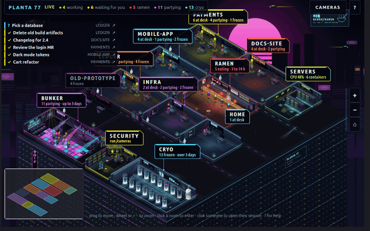

# planta-77

A [Claude Code](https://code.claude.com) mod that turns your sessions into characters on a cyberpunk office floor, so you can see at a glance who is working, who is waiting for you and who was forgotten days ago.



*`/office` shows the whole floor, flies into the room of one project, zooms on a session that is waiting, visits the ramen bar and the bunker, and then switches to the security cameras. Every session, project and container in the animation is made up.*

> The interface is in English. Set the `language` option to `es` to see it in Spanish.

## What it does

- **`/office`: one room per project.** Sessions of the same project share a room and each one is a character at a desk. Each folder where you opened sessions becomes a room, worktrees join the room of their repo, and with `ai_grouping` on, folders of the same product (a service and its docs, for example) share one room. Five special rooms complete the floor: the servers, the ramen bar, the bunker, security and cryo.
- **One state per session**, read from the session metadata and the tail of its transcript:

  | State | Shown as | When |
  | --- | --- | --- |
  | Working | `WORKING`, at the desk with a live trace of its last tools | A turn is running |
  | Your turn | `YOUR TURN` with a "Done! Your turn" bubble | It finished less than 30 minutes ago |
  | Permission | `ASKS PERMISSION` with the command it wants to run | It is waiting for a permission prompt |
  | Question | `ASKS YOU` with the question | It asked you something |
  | Idle, standby | `IDLE`, `STANDBY` | Up to 90 minutes and up to 3 hours without use |
  | Ramen | `RAMEN BREAK`, at the ramen bar | Up to 14 hours without use |
  | Party | `PARTYING`, in the bunker | Up to 3 days without use |
  | Cryo | `CRYO`, frozen in a capsule | More than 3 days without use (pinned sessions stay at the party) |

- **A floor you can fly around.** The camera moves inside the pane itself, so dragging, zooming and flying to a room are smooth and never wait for a redraw. Labels keep the same size on screen at every zoom and show more detail the closer you are: room plates from afar, names and states in a room, live traces up close.
- **The sessions that wait for you, always in sight.** A queue in the corner lists them by urgency. Click one to fly to it, or its arrow to open the session. `N` and `P` jump to the next and the previous one.
- **A card for every session.** Point at a character to see its title, state, room, how long ago it was used, its subagents, what it asks and its last tool. Click to open the session.
- **A minimap** shows where you are on the floor. Click or drag on it to move.
- **`/cameras`: the security room.** One camera per room, with the ones that need you blinking, plus the last tools used by every session and the system load. Click a camera to fly to its room, a marked character or a trace to open its session.
- **Works with heat-gate.** When [heat-gate](https://github.com/enzovalley9/heat-gate) is installed, the server room and the security room also show the CPU, temperature, memory and Docker containers. Without it those panels say so.
- **Pipelines and merge requests from other mods.** If another mod keeps CI pipelines (`radar.pipelines`) or merge requests (`mrs.mrs`) in its plugin store, the security room shows them too. The fields it reads are in [`hooks/lib/collect.mjs`](hooks/lib/collect.mjs).
- **Cheap to keep open.** One session reads the sessions and shares the snapshot with the others, the transcripts are read from the end only, the drawings are sent once and reused while nothing changes, and the pane refreshes every 5 seconds while it is open and stops when you close it.

## Controls

| Do this | To |
| --- | --- |
| Drag | Move around the floor |
| Mouse wheel, `+` `−` | Zoom at the pointer |
| Double click (with Shift) | Zoom in (out) |
| Click a room | Fly into it |
| Click a character | Open its session |
| `N` `P` | Next and previous session waiting for you |
| `Enter` | Open the highlighted session |
| `1` to `9` | Jump to a room |
| `0` `F` | Whole floor |
| Arrows, `WASD` | Move |
| `C` | Switch between the office and the cameras |
| `?` | Show the controls |

`/office <room>` opens the pane straight on a room, by project name or `ramen`, `bunker`, `servers`, `security`, `cryo` (the Spanish names of the rooms work too).

## Privacy

Everything is read locally: the session list of the desktop app, the tail of each transcript and the stores of the other mods. Before tool traces, permission requests, questions and summaries are drawn or saved in the cache, the mod masks the secrets it recognizes: known token formats (GitLab, GitHub, `sk-` API keys, Slack, AWS access key IDs, JWTs and Vault tokens), `Authorization` and `PRIVATE-TOKEN` headers, `Bearer` and `Basic` credentials, passwords in URLs, assignments such as `password=`, `DB_PASS=` or `token:` (also as JSON keys), flags such as `--password` and `--token`, `-p` in mysql, mariadb, docker login, sshpass and rabbitmqadmin, `-a` in redis-cli, `-u user:password` in curl, and hexadecimal strings of 40 characters or more. It works by patterns: a secret in a shape it does not recognize is shown as it is, and session titles and folder paths are drawn unmasked.

With `ai_grouping` on, the mod asks Claude Haiku, through your own Claude Code, to group folders that belong to the same project. That request contains the folder paths (with your home folder shortened to `~`), the names of the repos inside them, the number of sessions and the session titles, with the same masking. It is sent once and again only when a new folder appears. Turn `ai_grouping` off to keep the grouping fully local.

## Requirements

- The Claude desktop app with sessions in its Code tab, on Linux or macOS. The sessions are read from `~/.config/Claude/claude-code-sessions` on Linux and `~/Library/Application Support/Claude/claude-code-sessions` on macOS.
- **Desktop app only.** The floor is drawn in the side pane of the desktop app. In the Claude Code CLI the pane shows a text summary instead: sessions per room and the ones waiting for you. Tests run with Claude Code 2.1.291.
- The live view uses parts of the pane that are not in the public API of mods yet. If the app refuses them, the mod switches by itself to a compatible mode: the same floor as a still picture, where you can still point at sessions and open them. You can force that mode with the `compat_mode` option.

## Install

```bash
claude plugin marketplace add enzovalley9/planta-77
claude plugin install planta-77@planta-77
```

In a session that is already open, `/reload-plugins` loads it without a restart. Then run `/office` or `/cameras`.

## Options

Set them in `/plugin`, or pass `--config KEY=VALUE` to `claude plugin install`.

| Option | Default | Meaning |
| --- | --- | --- |
| `language` | `en` | `en` or `es` |
| `party_desks` | `false` | Keep an empty desk in their room for sessions that are partying in the bunker |
| `ai_grouping` | `true` | Ask Claude Haiku to group folders of the same project |
| `refresh_seconds` | `5` | Seconds between updates while the pane is open |
| `container_prefix` | empty | Prefix to drop from Docker container names in the server room, such as your compose project name |
| `wheel_zoom` | `true` | Zoom with the mouse wheel. Turn it off if the pane jumps when you scroll |
| `compat_mode` | `false` | Draw the floor as a still picture, without camera movement |

## Uninstall

```bash
claude plugin uninstall planta-77@planta-77
```

The mod keeps a small cache in `~/.claude/plugins/data/planta-77`, which you can delete afterwards.

## Tests

```bash
claude plugin test
claude plugin validate .
```

The tests build a fake home folder with twenty sessions, so they never read your own.

`/office diag` flies the camera around for a few seconds and reports the frames per second it reached in your pane. `/office dump <folder>` writes the model and every drawing layer to a folder.

## What is new in 1.0

- The camera now lives in the pane: zooming and moving no longer redraw the scene, which was what made the old zoom slow.
- Every room was redrawn, with a skyline, lighting without filters and animations that cost almost no CPU.
- New: the waiting queue, session cards, the minimap, keyboard control, flying to rooms and sessions, the camera wall, the compatible mode and the two options above.

## License

[MIT](LICENSE)
